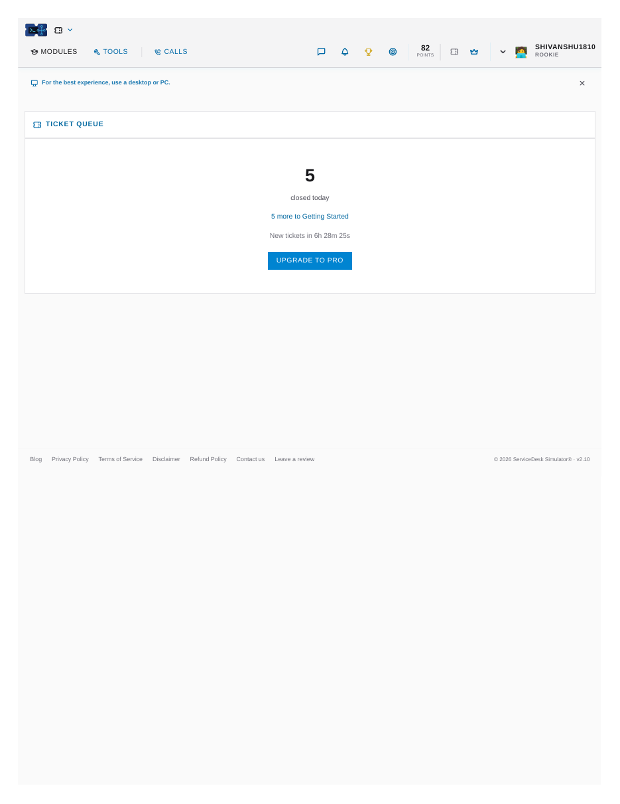
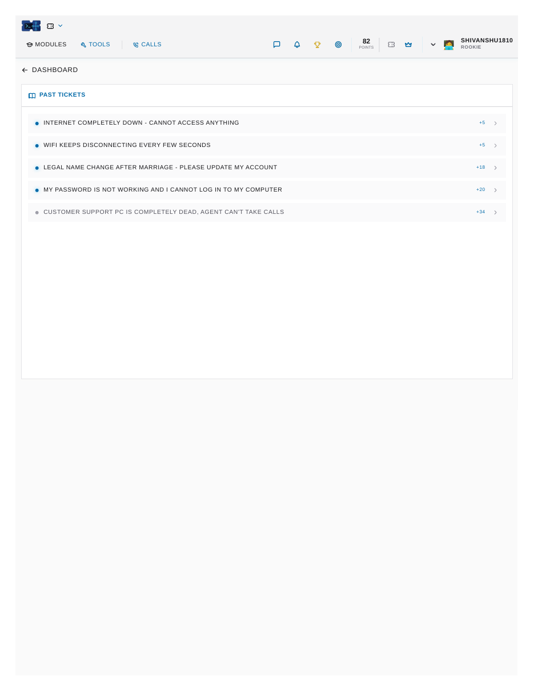
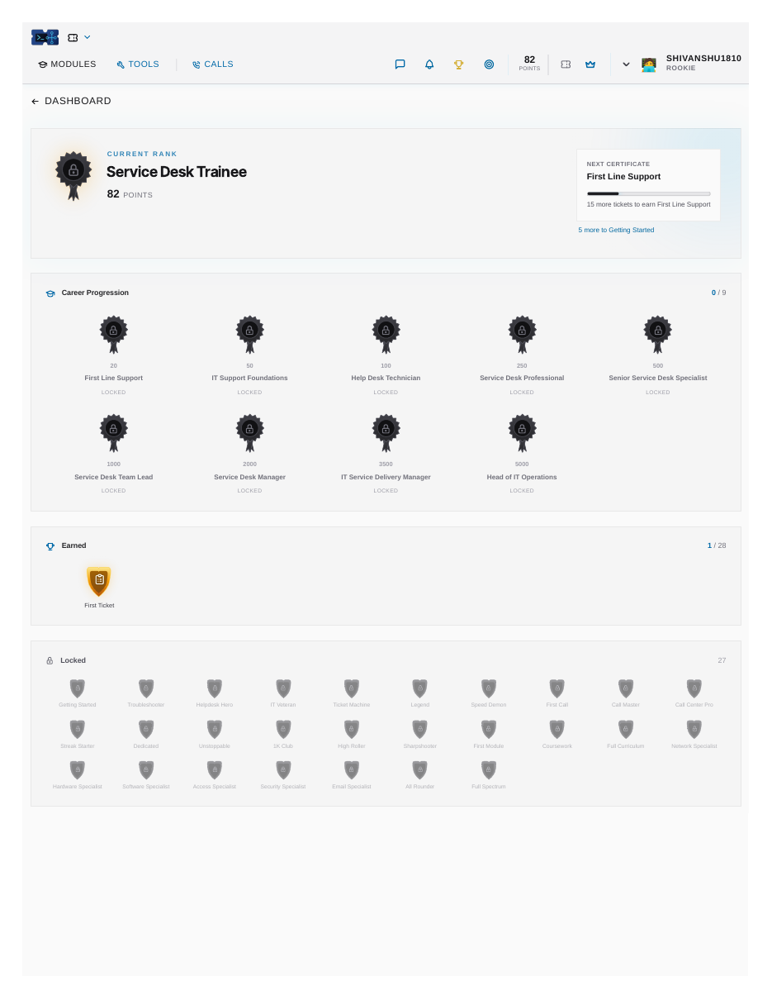
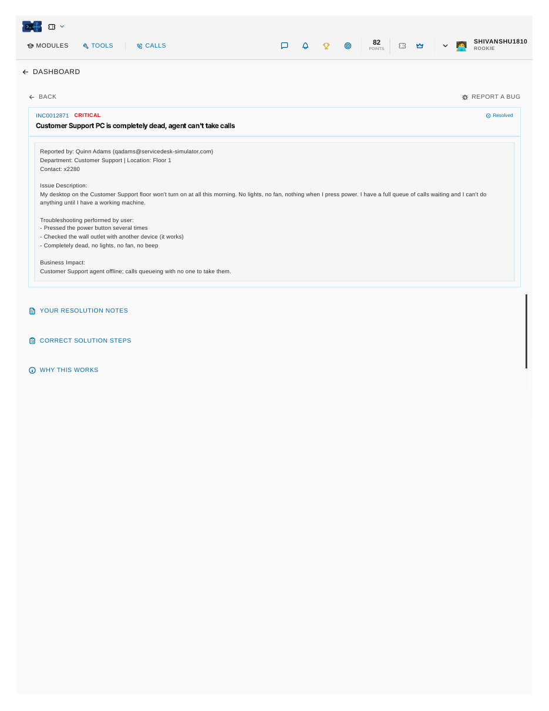
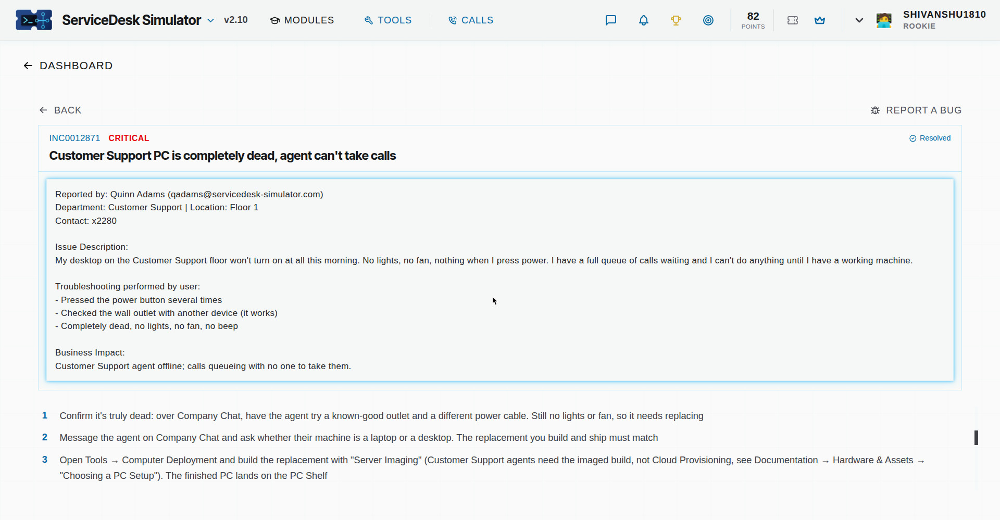
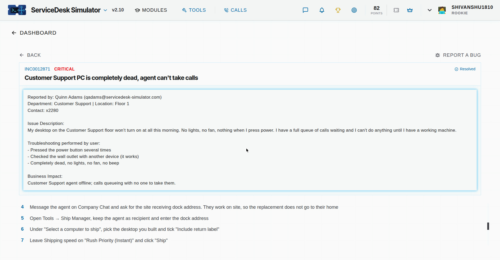
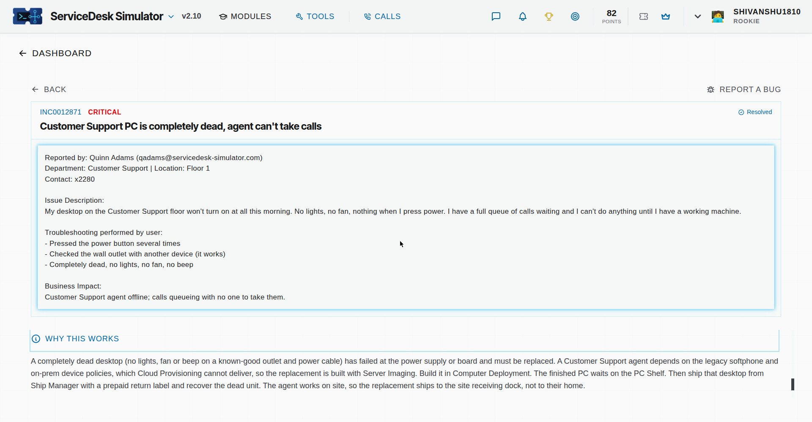

# Service Desk Daily Tickets Simulator

I practice service desk tickets every day on the ServiceDesk Simulator (servicedesk-simulator.com) to keep my troubleshooting sharp between real roles. This repo is my daily log: what tickets came in, what the problem turned out to be, and how I fixed each one.

## November 6, 2026 — 5 tickets closed, 82 points

**1. Customer Support PC completely dead (CRITICAL, +34)**
The PC died after a power outage and would not turn on at all. I checked the outlet and tried a different power cable first, no change. The power supply had failed. I imaged a replacement desktop with the deployment tool, registered it in the asset manager as SD2036, and shipped it rush to the user with a return label for the dead machine. She confirmed the new PC arrived and works.

**2. Password not working, cannot log in (HIGH, +20)**
The user came back from a three week vacation and her password had expired, and she could not change it from the login screen. I verified her identity with a code first, then reset the password in the directory and sent her the temporary one securely, with instructions to change it at first sign in.

**3. Legal name change after marriage (LOW, +18)**
Updated the account from Amanda Foster to Amanda Reyes, set the new primary email, and kept the old email address as an alias so nothing sent to the old address is lost. HR had already approved the change.

**4. WiFi keeps disconnecting every few seconds (CRITICAL, +5)**
This one was not the user at all. Every internal system in the server room checked out fine, but the internet provider (Metro ISP) was down with a 1 to 2 hour restore time. I posted an outage announcement with the ETA to the whole company chat so everyone stopped opening duplicate tickets.

**5. Internet completely down (HIGH, +5)**
Same Metro ISP outage as ticket 4. Closed it against the outage announcement with a note that no fix was needed on the user machine.

## Screenshots

Dashboard, 82 points, 5 tickets closed today:

All 5 resolved tickets:

Achievements, Service Desk Trainee rank and the First Ticket badge:

The critical ticket, my resolution notes (the failed power supply, the replacement desktop SD2036 imaged and shipped with a return label):

The correct solution steps for that ticket, part 1:

Steps, part 2:

Why the fix works:

## What I practice here

Ticket triage by priority, password resets with identity verification, account updates in the directory, hardware failure diagnosis, workstation imaging and deployment, asset registration, and outage communication. These are the same day to day tasks I did as a Tier 1 Service Desk Analyst at Royal Victoria Regional Health Centre, on a smaller scale.

I add new entries as I work more tickets.
